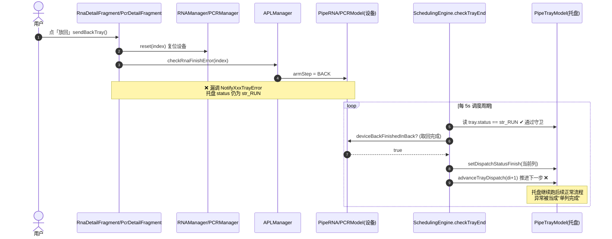
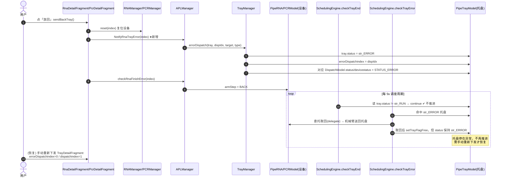

# 时序图 · 修复前后对比

## 修复前（Bug）：放回/复位后托盘仍继续下一步

## 修复后：放回/复位把托盘标异常，停止后续

> 关键差异：修复后在 `checkXxxFinishError`（设备 BACK）**之前**先 `NotifyXxxTrayError`（托盘 str_ERROR），
> 使 `checkTrayEnd` 的 `!str_RUN → continue` 守卫跳过该托盘，改由 `checkTrayError` 取回并保持异常。
