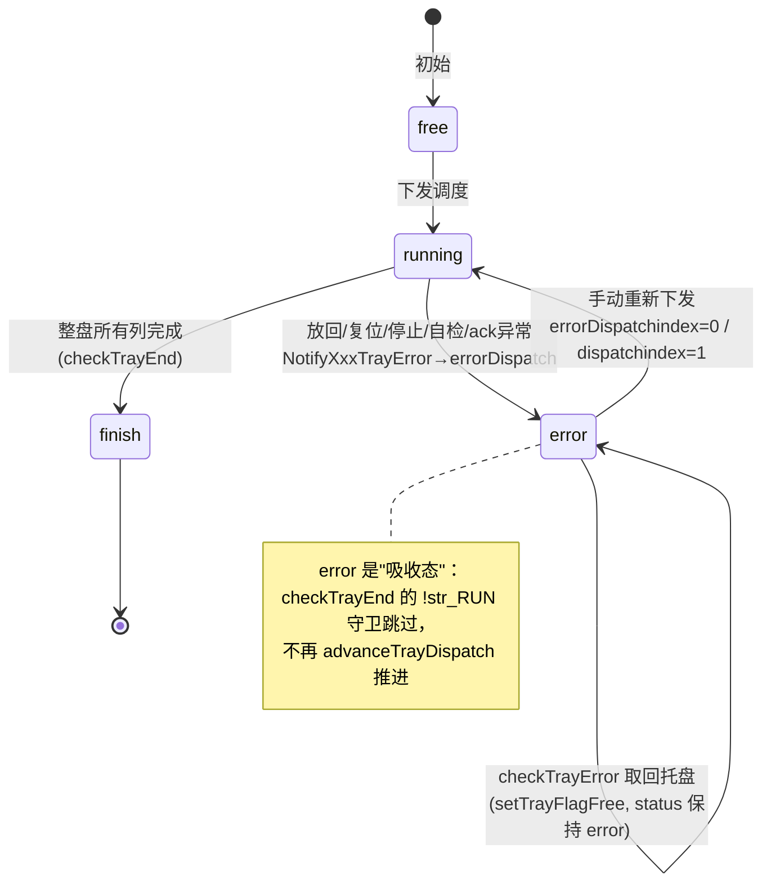
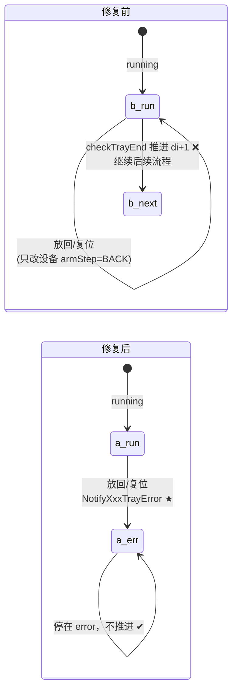
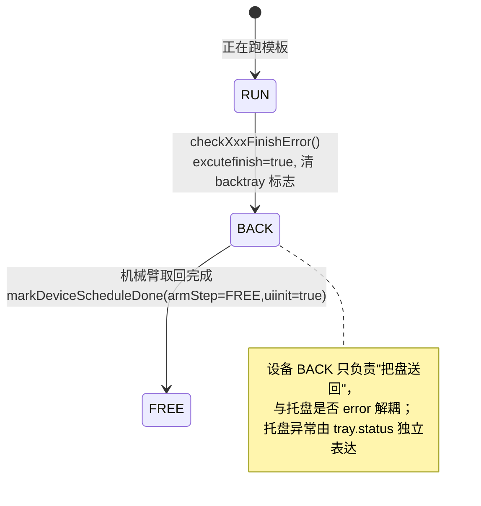

# 状态图 · 托盘 status 与 设备 armStep

## 托盘 PipeTrayModel.status 状态机（修复后）

## 修复前 vs 修复后（同一异常事件的托盘走向）

## 设备 armStep（RNA/PCR）在放回/复位链路

> 要点：**设备状态(armStep) 与 托盘状态(tray.status) 是两条独立的状态线**。
> 修复前只推了设备到 BACK，托盘线没进 error，于是托盘线继续被 checkTrayEnd 推进——这正是 bug。
> 修复后两条线同时正确：设备 BACK 取回 + 托盘 error 停推进。
