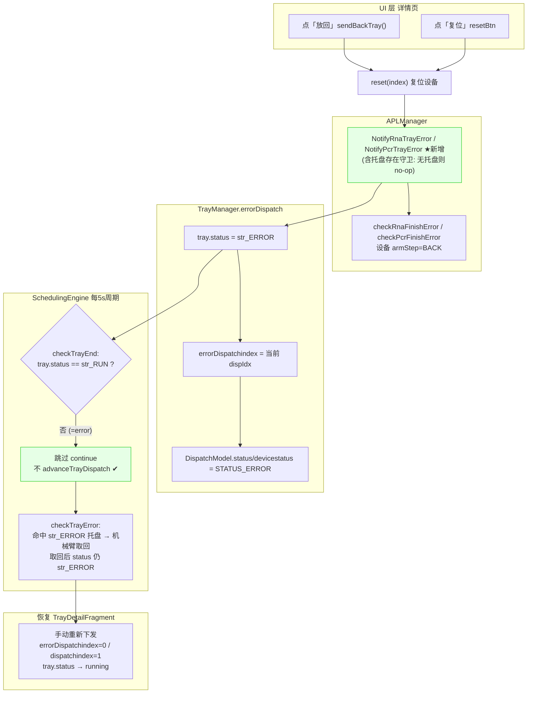
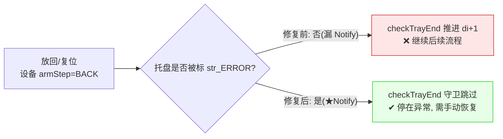

# 一图流 · 放回/复位 → 异常 → 取回 → 恢复（泳道 + 状态标注）

## 修复前后对照（同一路径的分叉）

## 触发入口汇总（本次统一后）

| 入口 | 是否标托盘异常 | 说明 |
|---|---|---|
| 停止 stopBtn | ✔（原有） | `NotifyXxxTrayError` |
| 自检 SelfcheckFragment | ✔（原有） | 批量 `NotifyXxxTrayError + checkXxxFinishError` |
| ack 异常 (模板下发失败/超时) | ✔（前次修复） | Handler `MSG_AckError_*` |
| **放回 sendBackTray** | **✔（本次★）** | 补 `NotifyXxxTrayError` |
| **复位 resetBtn** | **✔（本次★）** | 补 `NotifyXxxTrayError` |
